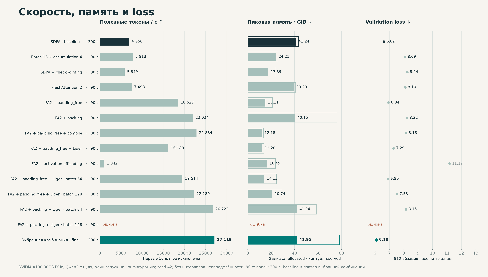
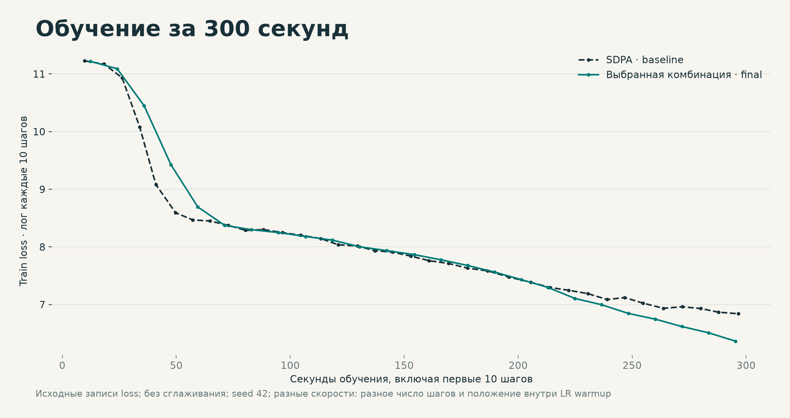

# HW2: ускорение обучения и кольцевые коммуникации

| Условия | Значение |
| --- | --- |
| GPU / runtime | {"gpu": "NVIDIA A100 80GB PCIe", "torch": "2.6.0+cu118", "transformers": "4.56.2", "trl": "0.23.1", "datasets": "3.6.0"} |
| Модель | Qwen3 с нуля; hidden_size=2048, num_hidden_layers=12, num_attention_heads=16, num_key_value_heads=8, intermediate_size=8192, head_dim=128, use_cache=False |
| Токенизатор | ai-forever/rugpt3small_based_on_gpt2; vocab=50257; revision: train.py |
| Данные | Wikipedia 20231101.ru; первые 500 статей: validation, следующие 50 000: train |
| Абзацы | До 8 на статью, ≥80 символов, ≥32 токенов; truncation 511 + EOS |
| Объём | train: 244768 абзацев, 47231 статей, средняя длина 90.98; validation: 2928 абзацев, 484 статей, средняя длина 91.98 |
| Разделение и хеши | [verification.json](verification.json); raw data_audit.json внутри logs.zip |
| Packing BFD | Сортировка и перестановка абзацев; несколько абзацев в packed row; batch × accumulation: packed rows вместо исходных абзацев |
| Обучение | BF16=True; TF32=True; length=512; adamw_torch_fused |
| LR | 0.0003; constant_with_warmup; warmup=200 шагов; weight decay=0.01 |
| Повторы | Один запуск на конфигурацию; seed=42, data_seed=42; интервалы не оценивались |
| Длительность | baseline/final: 300 с; поисковые пробы: 90 с; остановка после целого шага |
| Скорость | Полезные target tokens / сумму step_seconds; первые 10 optimizer steps исключены |
| Память | Пиковые allocated и reserved; GiB = bytes / 2³⁰; замер до validation |
| Validation | Первые 512 проверочных абзацев; loss взвешен по 50694 target tokens |
| Выбор | Максимум конечной tokens_per_second среди 11 успешных измеренных проб; выбрана packing_liger64 |
| Граница сравнения | 90 с и 300 с дают разные числа шагов, LR warmup и объёмы данных; loss не изолирует эффект флага |
| Подтверждение | final: повтор выбранной конфигурации с нуля; тот же seed и validation; независимого теста нет |

| Конфигурация | Лимит, с | Attention | Batch × accumulation | Флаги |
| --- | --- | --- | --- | --- |
| baseline | 300 | sdpa | 32 × 2 | нет |
| batch16 | 90 | sdpa | 16 × 4 | нет |
| checkpoint | 90 | sdpa | 32 × 2 | gradient_checkpointing |
| fa2 | 90 | flash_attention_2 | 32 × 2 | нет |
| padding_free | 90 | flash_attention_2 | 32 × 2 | padding_free |
| packing | 90 | flash_attention_2 | 32 × 2 | packing |
| padding_compile | 90 | flash_attention_2 | 32 × 2 | torch_compile, padding_free |
| padding_liger | 90 | flash_attention_2 | 32 × 2 | use_liger_kernel, padding_free |
| offloading | 90 | flash_attention_2 | 32 × 2 | activation_offloading |
| padding_liger64 | 90 | flash_attention_2 | 64 × 1 | use_liger_kernel, padding_free |
| padding_liger128 | 90 | flash_attention_2 | 128 × 1 | use_liger_kernel, padding_free |
| packing_liger64 | 90 | flash_attention_2 | 64 × 1 | use_liger_kernel, packing |
| packing_liger128 | 90 | flash_attention_2 | 128 × 1 | use_liger_kernel, packing |
| final | 300 | flash_attention_2 | 64 × 1 | use_liger_kernel, packing |

| Запуск | Факт, с | Шагов | После прогрева | Токенов/с | × baseline | Allocated GiB | Reserved GiB | Val loss | Статус |
| --- | --- | --- | --- | --- | --- | --- | --- | --- | --- |
| baseline | 300.4 | 365 | 355 | 6950 | 1.00× | 41.24 | 43.44 | 6.620 | ok |
| batch16 | 90.1 | 122 | 112 | 7813 | 1.12× | 24.21 | 26.00 | 8.089 | ok |
| checkpoint | 90.5 | 91 | 81 | 5849 | 0.84× | 17.39 | 23.97 | 8.238 | ok |
| fa2 | 90.3 | 117 | 107 | 7498 | 1.08× | 39.29 | 41.01 | 8.099 | ok |
| padding_free | 90.1 | 293 | 283 | 18527 | 2.67× | 15.11 | 21.24 | 6.936 | ok |
| packing | 90.8 | 62 | 52 | 22024 | 3.17× | 40.15 | 76.20 | 8.221 | ok |
| padding_compile | 90.0 | 106 | 96 | 22864 | 3.29× | 12.18 | 13.51 | 8.158 | ok |
| padding_liger | 90.2 | 239 | 229 | 16188 | 2.33× | 12.28 | 13.97 | 7.293 | ok |
| offloading | 92.2 | 15 | 5 | 1042 | 0.15× | 16.45 | 23.58 | 11.175 | ok |
| padding_liger64 | 90.0 | 302 | 292 | 19514 | 2.81× | 14.15 | 24.76 | 6.896 | ok |
| padding_liger128 | 90.1 | 174 | 164 | 22280 | 3.21× | 20.74 | 29.17 | 7.532 | ok |
| packing_liger64 | 90.1 | 74 | 64 | 26722 | 3.84× | 41.94 | 58.50 | 8.149 | ok |
| packing_liger128 | нет замера | нет | нет | нет замера | нет | нет замера | нет замера | нет замера | OOM |
| final | 300.1 | 254 | 244 | 27118 | 3.90× | 41.95 | 78.25 | 6.103 | ok |

Checkpointing сократил память на 57.8%, пересчитывая активации; скорость снизилась на 15.8%.

Удаление padding исключило вычисления на заполнителях; измеренная скорость выросла относительно FlashAttention2 в 2.47 раза.

Выбранная комбинация дала 3.90× скорости бейзлайна; проверочный loss снизился с 6.620 до 6.103.

| Воспроизведение | Команда / формула |
| --- | --- |
| Сборка | `docker build -t hw2 .` |
| GPU-среда | `docker run --rm -it --gpus device=0 -v "$PWD:/app" hw2 bash` |
| Чистый каталог | `mkdir reproduce; cp train.py run_experiments.py experiments.json reproduce/; cd reproduce` |
| Baseline | `python run_experiments.py --case baseline` |
| Пробы | `python run_experiments.py --sequence batch16 checkpoint fa2 padding_free packing padding_compile padding_liger offloading padding_liger64 padding_liger128 packing_liger64 packing_liger128` |
| Final | `python run_experiments.py --case final` |
| Графики, локально | `python -m pip install matplotlib==3.11.0`; `python plot_results.py` |
| Collectives | `torchrun --standalone --nproc_per_node=4 check.py` |
| Ускорение | tokens_per_second(final) / tokens_per_second(baseline) = 27118.34 / 6950.00 = 3.90× |

| Артефакт | Ссылка / содержимое |
| --- | --- |
| Сырые результаты | [logs.zip](logs.zip): results/*/summary.json, settings/*.json, logs/*.log, logs/*.status.json, train_template.py, data_audit.json |
| Параметры | [experiments.json](experiments.json), [train.py](train.py), [run_experiments.py](run_experiments.py) |
| Проверки | [verification.json](verification.json), [check.py](check.py), [test_collectives.py](test_collectives.py) |
| Коммуникации | [communications.ipynb](communications.ipynb), [collectives.py](collectives.py) |
| Графики | [comparison.svg](figures/comparison.svg), [training.svg](figures/training.svg) |
| Исходный контракт | train_template.py внутри [logs.zip](logs.zip); SHA256: eb24509433f8cf1ed54e5b19356e9cb4431b54a842e18daebcb70db92d76eba3 |
