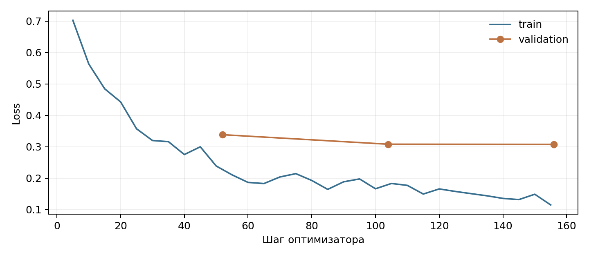

# ДЗ3: SFT для function calling

[Notebook с выводами](sft_function_calling_hw.ipynb): Qwen2.5-0.5B-Instruct, полное SFT, три эпохи на H100 за 105 секунд.

| Модель | Язык | Tool set accuracy | Exact match |
|---|---|---|---|
| base | EN | 75% | 55% |
| SFT | EN | 95% | 92.5% |
| base | RU | 75% | 20% |
| SFT | RU | 85% | 85% |

Validation loss: 0.307; четыре CPU-проверки проходят, маска сохраняет исходный текст всех 922 train/validation диалогов.

В демонстрациях потерялось количество молока; относительный нагрев спальни дал 24°C вместо 25°C.

На тесте остались вызовы для неподдерживаемых запросов, ошибки количества и пропуски нужных действий.



[Метрики](outputs/eval_results.csv) · [Десять запросов](outputs/comparison.json) · [Пять сценариев](outputs/agent_scenarios.json)

```bash
python -m venv .venv
.venv/bin/pip install -r requirements.txt
.venv/bin/jupyter lab sft_function_calling_hw.ipynb
```

[Статус проверок и хеши данных](outputs/verification.json)
