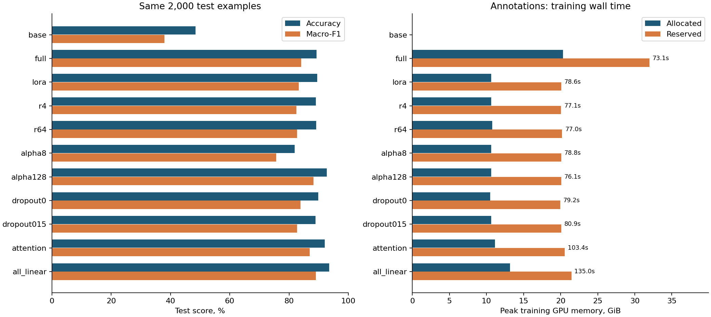
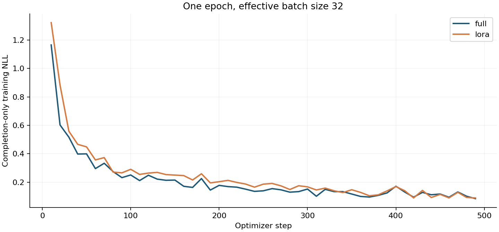

# ДЗ4: Full Fine-Tuning и LoRA

Qwen2.5-1.5B-Instruct, классификация шести эмоций, реальные запуски на `avi-gn-fsk40`, H100 80 GB, 31 октября 2026 года. Full FT и опорная LoRA дали близкую accuracy; Full FT выше по macro-F1. LoRA потребовала меньше памяти, но не ускорила обучение в этом сетапе.

[Полная таблица](outputs/metrics.csv) · [Сырые результаты и логи](outputs/raw_results.zip) · [Разбор десяти примеров](outputs/manual_review.json) · [Проверки](outputs/verification.json)

## Данные и задача

Вариант А: [dair-ai/emotion](https://huggingface.co/datasets/dair-ai/emotion), конфигурация `split`. Это готовые короткие английские тексты с шестью метками: `sadness`, `joy`, `love`, `anger`, `fear`, `surprise`. Датасет достаточно большой для сравнения полного обучения и адаптеров, при этом позволяет оценивать ответы по известным меткам без LLM-судьи. Короткие ответы делают серию контролируемых экспериментов доступной на одной H100 на запуск.

Исходные train/validation/test: 16 000 / 2 000 / 2 000. Дубликаты определяются по `casefold` и нормализованным пробелам. Приоритет: test, затем validation, затем train; распределение по официальным частям сохраняется. Удалены 47 train и 5 validation записей; test не изменился. В 51 случае повтор текста имел другую метку. Конфликт не исправлялся предположением о «правильной» эмоции: оставлена первая запись из приоритетной части.

Итог: **15 953 train / 1 995 validation / 2 000 test**. Нормализованные тексты внутри и между частями не повторяются. SHA256, распределения классов и число target tokens записаны в `data_manifest.json` внутри архива и [verification.json](outputs/verification.json). Максимальная длина закодированного train-примера — 120 токенов; обрезанных текстов нет.

Примеры из test, также используемые в качественном разборе:

| ID | Текст | Метка |
| --- | --- | --- |
| test:0 | im feeling rather rotten so im not very ambitious right now | sadness |
| test:3 | i left with my bouquet of red and yellow tulips under my arm feeling slightly more optimistic than when i arrived | joy |
| test:14 | i find myself in the odd position of feeling supportive of | love |
| test:6 | i felt anger when at the end of a telephone call | anger |
| test:5 | i cant walk into a shop anywhere where i do not feel uncomfortable | fear |
| test:65 | i feel a little stunned but can t imagine what the folks who were working in the studio up until this morning are feeling | surprise |

## Общий протокол

[Конфиги всех запусков](experiments.json) зафиксированы до получения результатов. Каждый запуск начинается с одной и той же [Qwen/Qwen2.5-1.5B-Instruct](https://huggingface.co/Qwen/Qwen2.5-1.5B-Instruct). Fine-tuning выполнен через Transformers Trainer, адаптеры — через PEFT; квантования нет.

| Параметр | Значение |
| --- | --- |
| Model revision | `989aa7980e4cf806f80c7fef2b1adb7bc71aa306` |
| Dataset revision | `cab853a1dbdf4c42c2b3ef2173804746df8825fe` |
| Среда | Python 3.11.9, torch 2.8.0+cu126, Transformers 4.56.2, PEFT 0.17.1, datasets 3.6.0, Accelerate 1.6.0 |
| Обучение | Одна полная эпоха, seed/data_seed=42, одинаковый порядок данных |
| Batch | 16 × accumulation 2 = 32; 499 optimizer steps |
| Контекст | max_length=160, chat template Qwen, правый padding на обучении |
| Loss | Только токены правильной метки и EOS; prompt и padding имеют labels=-100 |
| Оптимизатор | adamw_torch_fused, weight_decay=0.01, max_grad_norm=1 |
| LR / scheduler | Full FT: 2e-5; все LoRA: 2e-4; linear decay, warmup_ratio=0.05 |
| Вычисления | BF16, TF32, SDPA, без gradient checkpointing |
| Опорная LoRA | r=16, alpha=32, dropout=0.05, target_modules=[q_proj,v_proj], bias=none |
| Декодирование | Greedy, do_sample=False, max_new_tokens=8, batch=32, левый padding |
| Оценка | Все 1 995 validation и 2 000 test примеров, одинаковые ID и порядок |
| Checkpoint | Оценка обученных моделей после повторной загрузки сохранённых весов |

System prompt: `Classify the emotion. Reply with exactly one label: sadness, joy, love, anger, fear, surprise.` User message содержит исходный текст. Обучается именно causal LM, классификационная голова не добавляется. Full FT обновляет все 1 543 714 304 параметра модели; LoRA замораживает исходные веса.

Использованы две метрики одной целевой задачи:

- **Accuracy** — доля правильных меток, отражает общий успех классификации.
- **Macro-F1** — среднее F1 по всем шести классам; учитывает редкие эмоции наравне с частыми. В test 695 примеров joy и лишь 66 surprise. Поэтому для сравнения баланса классов важнее macro-F1.

Парсер удаляет только крайние пробелы. Любой ответ, отличный от одной из шести точных меток, считается ошибкой; invalid не является седьмым целевым классом. Отдельно сохранены число invalid, per-class precision/recall/F1, confusion matrix и диагностический completion NLL. Это не оценка общей языковой способности или отдельный бенчмарк; обычная perplexity для всей фразы здесь не измерялась.

Validation не участвовал в градиентах. Все конфиги и опорная LoRA заданы заранее, дополнительные варианты после просмотра test не добавлялись. Test не использовался для выбора checkpoint. Один seed, одна эпоха и заранее заданные разные LR не доказывают превосходства метода после полноценного подбора гиперпараметров.

## Full FT и опорная LoRA

| Модель | Test accuracy, % | Test macro-F1, % | Trainable params | Время train, с | Peak allocated / reserved, GiB |
| --- | --- | --- | --- | --- | --- |
| base | 48.50 | 37.95 | 0 | — | — |
| full | 89.30 | 84.03 | 1,543,714,304 | 73.08 | 20.30 / 31.98 |
| lora | 89.55 | 83.29 | 2,179,072 | 78.56 | 10.64 / 20.09 |

Опорная LoRA обучает 0.141% своих параметров: в 708 раз меньше, чем Full FT. Peak allocated снизился на 47.6%, с 20.30 до 10.64 GiB; reserved — с 31.98 до 20.09 GiB. Время выросло с 73.08 до 78.56 с, то есть на 7.5%. Малое число обучаемых весов не устраняет проход через исходную сеть; в этом замере экономия памяти не превратилась в ускорение.

Full FT выше на 0.74 п.п. macro-F1, опорная LoRA выше на 0.25 п.п. accuracy. Различие видно на редких классах: F1 surprise 66.67% против 60.18%, fear 88.13% против 84.76%; при этом love у LoRA выше: 81.05% против 74.68%. Независимые повторения и доверительные интервалы не оценивались, поэтому небольшие различия не объявляются устойчивым превосходством.

У Base 157/2 000 invalid-ответов, у Full FT и опорной LoRA — 0. Улучшение включает освоение формата, но рост accuracy примерно на 41 п.п. существенно больше 7.85 п.п., которые максимально могли бы дать исправления одного только invalid-формата.

Время измерено вокруг `trainer.train()` с CUDA synchronization: без загрузки, сохранения и оценки. Память — `torch.cuda.max_memory_allocated/reserved`, сброс перед train и чтение до оценки; это PyTorch allocator, не NVML-пик всей жизни процесса. На узле до трёх параллельных процессов, каждый на отдельной H100; CPU threads=4. Это эксплуатационные замеры одного запуска, не изолированный микробенчмарк. Full checkpoint имеет BF16-веса, адаптеры PEFT сохраняются в FP32 поверх замороженной BF16-базы; вычисления обучения используют BF16.

## Влияние параметров LoRA

Каждая строка меняет ровно один параметр относительно `lora`. Остальные параметры, данные, epoch, LR и seed одинаковы. `QV` = q_proj/v_proj, `QKVO` = четыре attention-проекции, `ALL` = attention и MLP gate/up/down; lm_head и embeddings не адаптируются. Все значения качества ниже в процентах. Обе validation-метрики и ресурсы каждого запуска также приведены в CSV.

| Конфиг | r | alpha | dropout | Модули | Val macro-F1 | Test accuracy | Test macro-F1 |
| --- | --- | --- | --- | --- | --- | --- | --- |
| lora | 16 | 32 | 0.05 | QV | 86.97 | 89.55 | 83.29 |
| r4 | 4 | 32 | 0.05 | QV | 86.92 | 89.10 | 82.50 |
| r64 | 64 | 32 | 0.05 | QV | 86.55 | 89.15 | 82.66 |
| alpha8 | 16 | 8 | 0.05 | QV | 76.09 | 81.90 | 75.66 |
| alpha128 | 16 | 128 | 0.05 | QV | 90.36 | 92.75 | 88.25 |
| dropout0 | 16 | 32 | 0.0 | QV | 87.27 | 89.90 | 83.87 |
| dropout015 | 16 | 32 | 0.15 | QV | 87.18 | 88.90 | 82.70 |
| attention | 16 | 32 | 0.05 | QKVO | 90.21 | 92.05 | 87.01 |
| all_linear | 16 | 32 | 0.05 | ALL | 92.10 | 93.55 | 89.06 |

- **r:** 4 → 16 → 64 даёт test macro-F1 82.50 → 83.29 → 82.66. Рост ранга не дал монотонного улучшения. Здесь alpha фиксирована: масштаб alpha/r одновременно меняется 8 → 2 → 0.5. Поэтому эксперимент показывает эффект настройки r в обычной LoRA, но не изолирует одну ёмкость при постоянном масштабе.
- **alpha:** 8 → 32 → 128 даёт 75.66 → 83.29 → 88.25 macro-F1 при одинаковых r и числе весов. Более сильный масштаб обновления оказался полезен за одну эпоху. Это согласуется с более слабой адаптацией alpha=8, но не доказывает универсальную причинную модель или оптимальность alpha=128.
- **dropout:** 0 / 0.05 / 0.15 даёт 83.87 / 83.29 / 82.70 test macro-F1. Отсутствие dropout немного лучше в этом запуске. На validation 0.15 выше 0.05, поэтому строгую монотонность и пользу регуляризации по одному seed утверждать нельзя.
- **target_modules:** QV → QKVO → ALL повышает macro-F1 83.29 → 87.01 → 89.06. Растут и обучаемые параметры: 2.18 → 4.36 → 18.46 млн; время: 78.56 → 103.43 → 135.02 с; allocated: 10.64 → 11.15 → 13.19 GiB. Эффект расширения модулей включает рост ёмкости адаптера.





## Вывод для выбранной задачи

В пределах этой заранее заданной серии предпочтительнее **LoRA с подходящими настройками**. Конфигурация `all_linear` имеет наибольший validation macro-F1 (92.10%) и наибольшие test accuracy/macro-F1 (93.55% / 89.06%). По сравнению с Full FT она обучает в 83.6 раза меньше параметров и использует на 35.0% меньше peak allocated памяти, но занимает в 1.85 раза больше времени обучения. Полное дообучение в этом сетапе быстрее; преимущества LoRA — память и качество лучших исследованных настроек.

Если важен компромисс затрат, `alpha128` даёт 92.75% accuracy / 88.25% macro-F1 за 76.14 с и 10.64 GiB: почти столько же времени, сколько Full FT, с существенно меньшей памятью. `all_linear` выигрывает у неё 0.81 п.п. test macro-F1 ценой примерно 1.77× времени. Это сравнение наблюдаемых конфигураций, а не доказательство глобального оптимума: LR Full FT не подбирался, использованы одна эпоха и один seed. Отдельный тест общей сохранности способностей модели не проводился.

Редкий surprise остаётся трудным даже у all_linear: recall 57.58%, F1 72.38%. В данных есть обрывки, смешанные эмоции и спорные метки; результат относится к этой задаче и её разметке.

## Качественный разбор одинаковых примеров

Десять ID выбраны до основных предсказаний: первый пример каждого класса и второй пример классов sadness/joy/love/anger в исходном порядке test. Ниже показаны сокращения текста; полные тексты, необработанные ответы и отдельный комментарий к каждому случаю находятся в [manual_review.json](outputs/manual_review.json). Разбор выполнен автором-ассистентом, без независимой человеческой панели; это качественная проверка, а не дополнительная оценка качества на репрезентативной выборке.

| ID и фрагмент | Gold | Base | Full FT | Опорная LoRA |
| --- | --- | --- | --- | --- |
| test:0, feeling rather rotten | sadness | sadness | sadness | sadness |
| test:3, feeling slightly more optimistic | joy | joy | joy | joy |
| test:14, feeling supportive of | love | love | love | love |
| test:6, i felt anger | anger | anger | anger | anger |
| test:5, shop ... feel uncomfortable | fear | sadness | fear | fear |
| test:65, i feel a little stunned | surprise | surprise | surprise | surprise |
| test:1, i feel shitty | sadness | sadness | sadness | sadness |
| test:7, relationship ... excitement ... accepted | joy | sadness | joy | joy |
| test:71, naughty school girl ... falling behind | love | sadness | love | love |
| test:9, grumpy tired and pre menstrual | anger | anger | anger | anger |

Совпадение с gold: Base 7/10, Full FT 10/10, опорная LoRA 10/10. Все ответы здесь соблюдают формат одной метки. В test:5 дообучение исправило sadness на более подходящую тревогу/fear. В test:7 смешаны неудачные отношения и радость поступления: ответ Base объясним, хотя не совпадает с gold. В test:71 метка love сомнительна; совпадение дообученных моделей скорее показывает усвоение разметки. Test:14 — незаконченная фраза, test:6 прямо называет эмоцию. Поэтому 10/10 на этих примерах нельзя трактовать как безошибочное понимание эмоций.

## Проверки и воспроизведение

Все 11 основных запусков и два одноступенчатых smoke-теста завершились с exit code 0. Для каждой обученной конфигурации проверены полная эпоха, 499 шагов, конечные loss, совпадение числа параметров с формулой LoRA и повторная загрузка checkpoint. Во всех основных обучениях обработаны 15 953 примера и 39 066 target tokens за эпоху. После сохранения удаляется обученная модель и для оценки создаётся новая из checkpoint.

[verification.json](outputs/verification.json) содержит независимый пересчёт accuracy и macro-F1 из всех 43 945 сохранённых предсказаний, проверку ID/текстов/меток, SHA256 данных и исходников. Формула F1 пересчитана отдельным кодом без вызова функции метрик пайплайна. Четыре CPU-теста проверяют изоляцию частей, completion mask, строгий парсер и изменение ровно одного LoRA-параметра. Архив содержит также исходник аудита, точную среду, историю loss, логи smoke и журнал GPU-времени.

Предупреждения Transformers о `torch_dtype`, PAD/EOS и игнорируемых sampling-флагах при greedy decoding не меняют протокол; они перечислены в проверках. Предупреждение PEFT при offline-сохранении относится к проверке изменения vocabulary по неприкреплённому `main`: vocabulary не расширялся, обучались только проекции, сохранённые адаптеры успешно загружены поверх зафиксированной базовой модели.

Из корня репозитория, Linux / Python 3.11 / CUDA-совместимый GPU:

```bash
cd hw4_lora
python3.11 -m venv .venv
.venv/bin/python -m pip install --index-url https://download.pytorch.org/whl/cu126 torch==2.8.0+cu126
.venv/bin/python -m pip install -r requirements.txt
.venv/bin/python -m unittest -v test_pipeline
.venv/bin/python data.py
.venv/bin/python -c 'import json; from huggingface_hub import snapshot_download; c=json.load(open("experiments.json")); snapshot_download(c["model"], revision=c["model_revision"])'
.venv/bin/python run_experiments.py --cases full lora --smoke --gpus 0
.venv/bin/python run_experiments.py --gpus 0
.venv/bin/python plot_results.py
```

До запуска runner веса обязательно скачиваются: runner работает offline. Для фактической параллельной схемы этого отчёта замените последнее `--gpus 0` на `--gpus 0 1 2`, предварительно выбрав три свободных GPU. Runner использует файловые lease-locks, проверяет занятость памяти и считает суммарное время GPU-процессов; общий лимит — 7 200 секунд, включая smoke, загрузку, сохранение и оценку. Модельные замеры в таблице считают только обучение. Законченные конфигурации пропускаются.

Отдельные воспроизводимые запуски: `.venv/bin/python train.py --case full` и `.venv/bin/python train.py --case lora`; остальные имена перечислены в [experiments.json](experiments.json). Для полностью нового повторения используйте пустой каталог результатов: `run_experiments.py --output reproduce --gpus 0`, затем `plot_results.py --output reproduce`. Во время повторения отдельные summary/predictions/checkpoint сохраняются в выбранной папке; для графиков достаточно либо этих JSON, либо приложенного архива.

Крупные веса сохранены на `avi-gn-fsk40:/home/mekashirskiy/dl-course-hw4-20261031/outputs/<case>/checkpoint/` и исключены из git. Репозиторий содержит код для их повторного обучения, а не сами многогигабайтные checkpoint. Результаты находятся в [raw_results.zip](outputs/raw_results.zip): `<case>/summary.json`, `training.json`, `training_history.json`, `validation_predictions.json`, `test_predictions.json`, `run.log`; отдельно — конфиги, источники, manifest данных и resource ledger.
