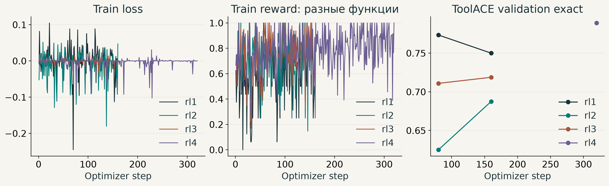

# ДЗ5: RL для function calling

[Notebook с выводами](rl_function_calling_hw.ipynb) · [Отчёт PDF](outputs/report.pdf) · [Полная таблица](outputs/results.csv)

Qwen/Qwen3.5-2B, только RL на ToolACE, TRL и LoRA rank 16. Три контролируемых конфигурации и дополнительный длительный запуск; полный checkpoint после merge оценивается исходным `evaluate.py`.

| Модель | Шаг | Overall | Simple | Multiple | Parallel | Parallel + Multiple | Irrel. |
| --- | --- | --- | --- | --- | --- | --- | --- |
| base | - | 68.93% | 66.00% | 78.67% | 56.00% | 80.00% | 64.00% |
| rl1 | 80 | 72.27% | 72.00% | 77.33% | 68.00% | 76.00% | 68.00% |
| rl2 | 160 | 75.73% | 80.00% | 78.67% | 68.00% | 82.00% | 70.00% |
| rl3 | 160 | 78.00% | 80.00% | 84.00% | 74.00% | 86.00% | 66.00% |
| rl4 | 320 | 76.13% | 76.00% | 82.67% | 70.00% | 88.00% | 64.00% |

Лучший наблюдаемый результат: **rl3, 78.00% overall**, на **9.07 п.п.** выше baseline. Более длинный RL4 не улучшил BFCL, при более высоком ToolACE validation и росте train reward. Один seed на конфигурацию; результат относится к исходному срезу из 350 примеров.



Для каждой конфигурации шаг выбирается по точности на 128 ToolACE validation примерах, при равенстве — более ранний. Обучение: 2 048 примеров, 25% no-call, 160 шагов, effective batch 16 ответов, 4 генерации на запрос. Диалоги разделены до нарезки; пересечение train/validation равно нулю. BFCL используется только для оценки. RL4 повторяет Dr. GRPO на 320 шагах из исходных весов, с финальным checkpoint и warmup 16 вместо 8; это дополнительный разведочный запуск. Для RL1-RL3 дополнительно измерены оба сохранённых шага 80/160: [результаты по шагам](outputs/bfcl_checkpoints.json); они не меняют правило выбора.

RL1 проверяет бинарную exact-награду с GRPO. RL2 меняет только награду на частичное совпадение имён и аргументов. RL3 меняет две связанные нормировки: Dr. GRPO и `scale_rewards=none`. Последнее сравнение не отделяет их индивидуальные эффекты. Формулы, гипотезы, ошибки и ответы на пять вопросов — в отчёте.

## Воспроизведение

Исходные [PDF и файлы задания](https://drive.google.com/drive/folders/1Ps26iBLmLtfUhbZ6pLAZ98WA6mH0Yh-K). `evaluate.py`, `bfcl.jsonl` и Dockerfile сохранены без изменений.

```bash
docker build -t rlvr-homework .
docker run --rm -it --gpus device=0 --ipc=host \
  -v "$PWD":/workspace -v rlvr-hf-cache:/cache rlvr-homework
uv pip install --system matplotlib==3.11.2 reportlab==5.1.0 \
  nbformat==5.11.1 nbclient==0.11.0 ipykernel==7.4.0 pillow==13.0.0
bash run_all.sh
```

Фактический запуск выполнен нативно на `avi-gn-fsk34`, H100 80GB, Python 3.12.14. Docker недоступен пользователю на узле. Пакеты из образа сохранены; PyPI-колесо использует Torch 2.11.0/CUDA 13.0. Точные версии: [окружение](outputs/environment.json), [freeze](outputs/environment.freeze.txt). Намеренный NumPy override повторяет Dockerfile задания.

```bash
uv venv --python 3.12.14 .venv
uv pip install --python .venv/bin/python \
  --override numpy-override.txt -r requirements.txt
CUDA_HOME=/usr/local/cuda-13.1 MAX_JOBS=4 CAUSAL_CONV1D_FORCE_BUILD=TRUE \
  uv pip install --python .venv/bin/python --no-build-isolation causal-conv1d==1.7.0
export PATH="$PWD/.venv/bin:$PATH"
python -m unittest test_data test_rewards test_training test_export
python prepare_data.py --train-size 2048 --validation-size 128 \
  --max-prompt-tokens 3072 --seed 42
bash run_gpu.sh 6 python evaluate.py Qwen/Qwen3.5-2B --output outputs/base
CUDA_VISIBLE_DEVICES= python verify_references.py
bash run_gpu.sh 0 bash run_experiment.sh rl1
bash run_gpu.sh 1 bash run_experiment.sh rl2
bash run_gpu.sh 2 bash run_experiment.sh rl3
for slot in 0 1 2; do
  name="rl$((slot+1))"
  other="$(python -c 'import json,sys; print(240-json.load(open(sys.argv[1]))["selected_step"])' "outputs/$name/training_summary.json")"
  CUDA_VISIBLE_DEVICES= python export.py "$name" --step "$other"
  bash run_gpu.sh "$slot" python evaluate.py "outputs/$name/merged-step$other" \
    --output "outputs/$name/step-$other"
done
bash run_gpu.sh 2 python train.py rl3 --steps 320 --output outputs/rl4
CUDA_VISIBLE_DEVICES= python export.py rl3 --root outputs/rl4
bash run_gpu.sh 2 python evaluate.py outputs/rl4/merged --output outputs/rl4
python analyze.py
```

Номера GPU в командах — фактически использованные слоты; перед воспроизведением выберите свои свободные ресурсы. `run_gpu.sh` предназначен для текущего прямого запуска на fsk34: две UUID-блокировки, проверка устройства, отдельный порт, предел три часа. На другом кластере используйте его штатный scheduler. Приведённые последовательные команды воспроизводят конфигурации; фактические три запуска выполнялись параллельно.

Seed данных и Trainer — 42. Colocated vLLM в TRL 1.16.0 использует engine seed 0 для единственного rank. Финальный evaluator использует seed 42, greedy decoding, thinking выключен и максимум 1 024 новых токена. Эти параметры, токенизатор и benchmark не менялись.

## Данные и результаты

[EDA и исключения](outputs/eda.json) фиксируют исходные 11 300 диалогов, дедупликацию, причины фильтрации, длины и состав сплитов. 2 176 эталонов проходят нативный шаблон и официальный парсер с exact reward 1: [проверка награды](outputs/reward_integration.json). Пустые tools, два EOS и нормализация JSON number обработаны отдельно; bool и строки не смешиваются с числами.

- Модель: `Qwen/Qwen3.5-2B`, revision `15852e8c16360a2fea060d615a32b45270f8a8fc`.
- Данные: `Team-ACE/ToolACE`, revision `6bda777c88d21e5a204703c1ee45597a8fa4f734`.
- `outputs/{base,rl1,rl2,rl3,rl4}/`: исходные `metrics.json` и все 350 строк `predictions.jsonl`.
- `outputs/rl*/`: конфигурация, история обучения, выбор шага, summary и проверка merged-весов.
- [Разбор ошибок](outputs/error_analysis.json), [итоговая проверка](outputs/verification.json).

Полные данные, адаптеры, merged-веса и сырые логи оставлены на `avi-gn-fsk34:/home/mekashirskiy/dl-course-hw5-20261031/`: `data/`, `outputs/rl*/adapters/`, `outputs/rl*/merged/`, `outputs/*/run.log`. Большие веса в Git не добавлены. SHA256 экспортов сохранены в `export_verification.json` каждого запуска. SFT и внешние обучающие данные не использовались.
