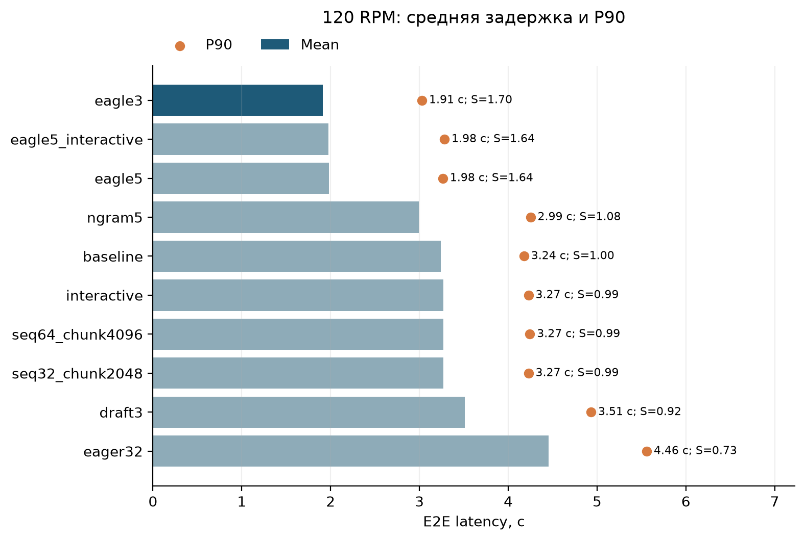
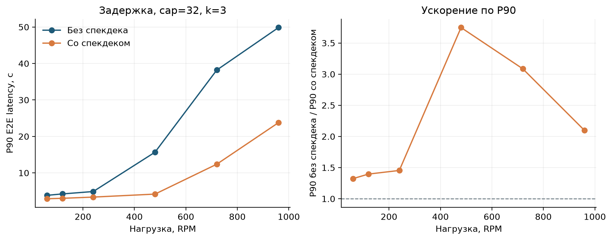
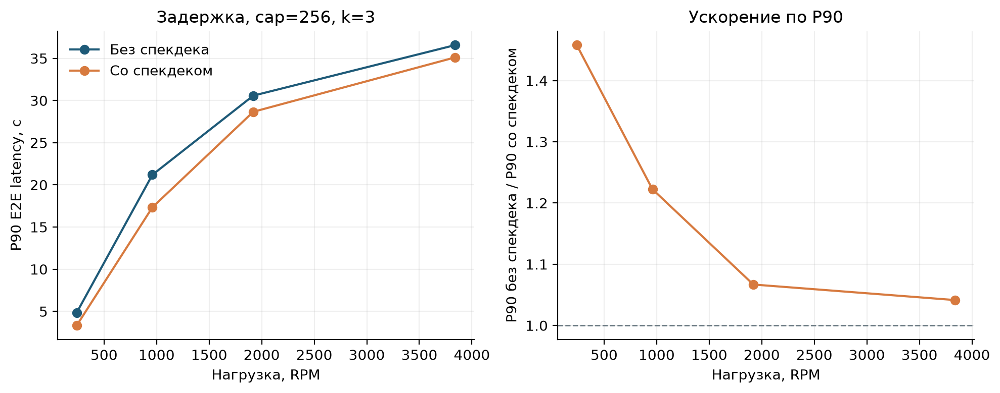
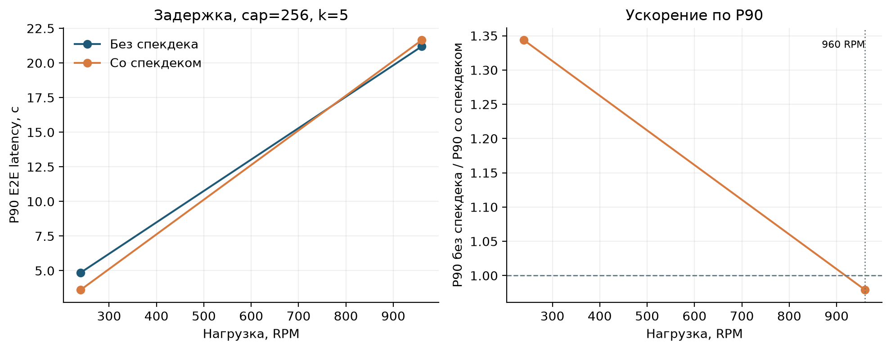
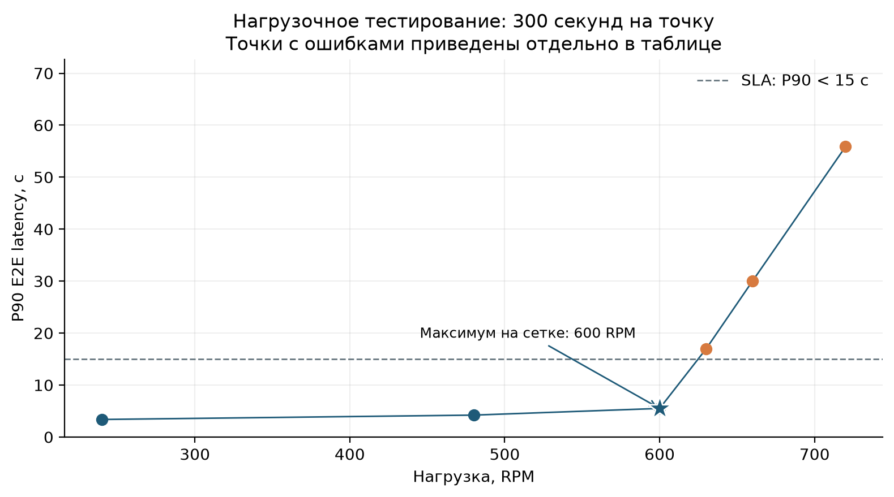

# ДЗ6: ускорение инференса

[Отчёт PDF](outputs/report.pdf) · [Полная таблица](outputs/results.csv) · [Основные замеры](outputs/raw_results.zip) · [Нагрузочные замеры](outputs/raw_load_results.zip)

<details>
<summary>Пересчитать CSV из двух архивов</summary>

Из папки `hw6`:

```bash
unzip -o outputs/raw_results.zip
unzip -o outputs/raw_load_results.zip
python analyze.py > /dev/null
```

Ожидается 39 прогонов; сохранённый и пересчитанный `outputs/results.csv` совпадают побайтово.

</details>

Qwen/Qwen3-8B в BF16, одна H100 80GB на `avi-gn-fsk34`. Температура 0, seed 42, максимум 512 новых токенов, thinking выключен. Используются все 640 исходных запросов без изменений.

## 1. Конфигурации при 120 RPM

**Лучший из проверенных вариантов — `eagle3`: Mean 1.910 с, P90 3.029 с, ускорение 1.698 относительно исходного baseline.** Его повтор дал Mean 1.918 с и P90 3.008 с.

| Конфигурация | Mean, с | P90, с | S | Средняя длина | Acceptance |
| --- | ---: | ---: | ---: | ---: | ---: |
| [baseline](configs/baseline.sh) | 3.243 | 4.177 | 1.000 | 419.58 | - |
| [draft3](configs/draft3.sh) | 3.509 | 4.932 | 0.924 | 419.96 | 52.5% |
| [eager32](configs/eager32.sh) | 4.456 | 5.558 | 0.728 | 420.93 | - |
| [eagle3](configs/eagle3.sh) | 1.910 | 3.029 | 1.698 | 419.89 | 31.8% |
| [eagle5](configs/eagle5.sh) | 1.979 | 3.263 | 1.639 | 420.52 | 21.1% |
| [eagle5_interactive](configs/eagle5_interactive.sh) | 1.976 | 3.282 | 1.641 | 420.14 | 21.0% |
| [interactive](configs/interactive.sh) | 3.269 | 4.228 | 0.992 | 420.21 | - |
| [ngram5](configs/ngram5.sh) | 2.993 | 4.251 | 1.083 | 420.33 | 21.9% |
| [seq32_chunk2048](configs/seq32_chunk2048.sh) | 3.272 | 4.228 | 0.991 | 420.87 | - |
| [seq64_chunk4096](configs/seq64_chunk4096.sh) | 3.269 | 4.243 | 0.992 | 419.97 | - |

Во всех строках — 640 успешных запросов, ошибок нет. Основная таблица содержит по одному опорному прогону; контрольные повторы сохранены отдельно. `S = Mean baseline / Mean конфигурации`. Длина — `output_sequence_length` из AIPerf; 512 является верхним пределом, ранний EOS разрешён.



Сначала уменьшались лимит одновременных последовательностей и бюджет chunked prefill: 32/2048 и 64/4096. Затем проверялись eager-режим, `interactivity` вместе с `-O3`, n-gram lookup, обычный draft Qwen3-0.6B и обученный EAGLE-3 speculator. У EAGLE сравнивались k=3 и k=5; для k=5 дополнительно проверялся `interactivity/-O3`. Полные команды находятся в `.sh`-файлах таблицы.

Меньшие лимиты и `interactivity/-O3` ускорения не дали. Разницу порядка 1% одного прогона не стоит считать устойчивым эффектом. `eager32` заметно медленнее соответствующего `seq32_chunk2048`: Mean вырос с 3.272 до 4.456 с. У n-gram Mean снизился до 2.993 с, но P90 не улучшился.

Обычный draft получил acceptance 52.5%, но оказался медленнее: Mean 3.509 с. EAGLE k=3 принял 31.8% предложенных токенов и дал Mean 1.910 с. Одного acceptance недостаточно для выбора: результат согласуется с разной ценой генерации черновика и проверки, но отдельно эта цена не профилировалась. Увеличение k до 5 снизило acceptance до 21.1% и ухудшило Mean до 1.979 с.

Средняя длина ответов в фиксированных конфигурациях отличается примерно на 0.3%, поэтому ускорение 1.7 не объясняется заметным сокращением ответа. В сравнении с baseline тексты отличаются в 537–558 из 640 случаев, длины — в 150–169; входные длины для тех же session ID совпадают. Качественная эквивалентность текстов не утверждается.

Контрольный baseline: Mean 3.263 с против 3.243 с исходного прогона, разница +0.62%. Его 479 из 640 ответов отличаются по тексту и 112 по длине при совпадающем векторе входных длин. Повтор EAGLE дал Mean 1.918 с против 1.910 с (+0.40%). В расчёте S исходный baseline не заменялся более медленным повтором.

Seed управляет генератором случайных чисел, но не гарантирует побитовую повторяемость online-ответов. vLLM описывает возможную зависимость от батча и численных ядер: [reproducibility](https://github.com/vllm-project/vllm/blob/v0.22.0/docs/usage/reproducibility.md), [batch invariance](https://github.com/vllm-project/vllm/blob/v0.22.0/docs/features/batch_invariance.md). Конкретная причина наблюдаемых расхождений отдельно не устанавливалась; baseline оставлен в режиме по умолчанию.

## 2. Спекулятивное декодирование и нагрузка

Парная проверка использует `seq32_chunk2048` и `eagle3`: все аргументы одинаковы, добавляется только speculative config. В каждой точке 640 запросов; 120 RPM взяты из опорных прогонов. Ограничение одновременных последовательностей — 32.

| RPM | P90 без спекдека, с | P90 EAGLE-3, с | S по P90 |
| ---: | ---: | ---: | ---: |
| 60 | 3.844 | 2.905 | 1.323 |
| 120 | 4.228 | 3.029 | 1.396 |
| 240 | 4.887 | 3.361 | 1.454 |
| 480 | 15.672 | 4.182 | 3.748 |
| 720 | 38.196 | 12.378 | 3.086 |
| 960 | 49.855 | 23.781 | 2.096 |



В диапазоне 60–960 RPM пересечения нет: EAGLE-3 быстрее по P90 во всех точках. После 480 RPM задержка обеих конфигураций растёт, но у варианта без спекдека очередь начинает заметно влиять раньше. При 960 RPM P90 составляет 49.855 с без спекдека и 23.781 с с ним. Ускорение по P90 максимально на сетке при 480 RPM: 3.748; к 960 RPM оно снижается до 2.096. Отсутствие пересечения в этой сетке не означает, что спекдек быстрее при любой нагрузке.

Это замеры на конечной пачке из 640 запросов, а не доказательство длительного SLA. Фактическая подача проверена по времени начала запросов; рост задержки не получен за счёт снижения заданного RPM клиентом.

## 2.1. Проверка с лимитом 256 последовательностей

При лимите 32 пересечения не было, поэтому отдельно проверен лимит 256. Внутри новой пары все параметры, кроме speculative config, одинаковы; относительно исходной пары меняется только `max-num-seqs`. Это проверка чувствительности к лимиту, а не замена выбранного деплоя.

| RPM | P90 без спекдека, с | P90 EAGLE-3, с | S по P90 | Max running без / с |
| ---: | ---: | ---: | ---: | ---: |
| 240 | 4.859 | 3.333 | 1.458 | 20 / 13 |
| 960 | 21.191 | 17.335 | 1.222 | 256 / 232 |
| 1920 | 30.576 | 28.660 | 1.067 | 256 / 246 |
| 3840 | 36.563 | 35.108 | 1.041 | 256 / 247 |



До 3840 RPM пересечения не найдено и при большем лимите. Max running — максимум серверной метрики `vllm:num_requests_running`; он подтверждает, сколько последовательностей действительно было активно, а не только допустимый лимит.

Сопоставление двух пар показывает зависимость результата от режима планировщика. Возможное объяснение — изменение цены проверки черновиков и обычного батчинга при росте числа активных последовательностей. Отдельного GPU-профилирования этих затрат нет, поэтому это интерпретация. Настройки EAGLE k=3 / 32 / 2048 и выбор лучшего варианта при 120 RPM не менялись.

## 2.2. Проверка k=5

У k=3 ускорение осталось положительным вплоть до 3840 RPM. Последний отдельный контроль — EAGLE k=5 при том же лимите 256 и нагрузках 240/960 RPM; точки без спекдека переиспользованы из предыдущей пары. Гипотеза до запуска: дополнительные предложения при k=5 мало увеличивают число принятых токенов на draft, но требуют больше работы draft-модели и проверки. Поэтому при большом числе активных последовательностей ускорение может исчезнуть.

| RPM | P90 без спекдека, с | P90 EAGLE k=5, с | S по P90 | Acceptance, % |
| ---: | ---: | ---: | ---: | ---: |
| 240 | 4.859 | 3.616 | 1.344 | 21.2 |
| 960 | 21.191 | 21.643 | 0.979 | 21.1 |



Для этой конфигурации первая измеренная точка с проигрышем — 960 RPM. При 240 RPM k=5 ещё быстрее, при 960 RPM уже медленнее; промежуточные значения не проверялись. При 960 RPM максимум активных последовательностей — 198. Разница по P90 на 960 RPM составляет около 2.1%. Контроль k=5 добавлен после основной сетки; выбор деплоя по фиксированным 120 RPM сохранён. Один прогон на точку, устойчивость порога и доверительные интервалы не оценивались.

## 3. Максимальная нагрузка при SLA

Для лучшего по Mean при 120 RPM варианта `eagle3` каждый запуск использует `load_test.sh`: 300 секунд подачи, constant arrival, timeout 120 секунд, затем полный drain. После грубой сетки граница уточнялась серединами интервала, кратными 15 RPM, до зазора не больше 5% от проходящей точки.

**Максимум на проверенной сетке — 600 RPM (10.00 RPS): P90 5.498 с. Следующая точка 630 RPM даёт P90 16.968 с и не проходит SLA.** Зазор — 5.00%. Условие строгое: P90 < 15 секунд, без ошибок и при подтверждённой подаче заданной нагрузки.

| RPM | P90 успешных, с | Effective P90, с | Успешных | Ошибок | SLA |
| ---: | ---: | ---: | ---: | ---: | ---: |
| 240 | 3.373 | 3.375 | 1199 | 0 | PASS |
| 480 | 4.212 | 4.212 | 2399 | 0 | PASS |
| 600 | 5.498 | 5.507 | 2999 | 0 | PASS |
| 630 | 16.968 | 16.968 | 3149 | 0 | FAIL |
| 660 | 30.031 | 30.041 | 3299 | 0 | FAIL |
| 720 | 55.873 | 55.874 | 3599 | 0 | FAIL |
| 960 | 118.284 | 118.284 | 3446 | 1353 | FAIL |



На графике только точки без ошибок. При 960 RPM 1353 из 4799 запросов (28.2%) завершаются TimeoutError; P90 118.284 с в таблице относится только к успешным ответам и не описывает все запросы. Эта точка не проходит SLA независимо от такого P90. Все ошибки сохранены в JSONL.

Короткий sweep при 720 RPM давал P90 12.378 с, а 300-секундный тест — 55.873 с. За более длительную подачу успевает накопиться очередь. Серверный num_requests_waiting в среднем вырастает с 0.005 при 480 RPM до 287.252 при 720 RPM; max running достигает лимита 32.

## Окружение и проверка

Фактический запуск нативный: vLLM 0.22.0, Python 3.12.14, Torch 2.11.0 / CUDA 13.0, transformers 4.57.6. Docker socket пользователю недоступен. Это отличие от исходного cu129-образа; все сравнения выполнены в одном нативном окружении на одной GPU. Для AIPerf отдельно установлены версии 0.13.0 и transformers 5.22.1, как в Dockerfile задания. Исходный Dockerfile сохранён.

Перед AIPerf и после завершения очищается prefix KV cache через штатный API. Прогрев — 40 запросов с concurrency 8; в метрики он не включается. Между warmup и profiling кеш повторно не очищается: это штатный порядок исходного скрипта. Загрузка весов и компиляция не входят в latency. Среднее и P90 независимо пересчитаны из всех profiling-записей JSONL; ответы после окончания подачи нагрузки сохраняются. Проверяется число запросов, уникальность ID, фактическая подача, client queue и полное завершение.


Проверка нагрузки использует profiling-записи, включая ответы после 300-й секунды: число started = 5 × RPM ± 1, span между первым и последним credit ≥ 299 с, фактический RPM отличается менее чем на 1%. На границах каждой минуты накопленное число credit и started отличается от ожидаемого не больше чем на один запрос; исходные минутные bins сохранены. Это допускает jitter границ, а не пропущенную нагрузку. Уникальность ID и полное завершение также проверяются.

Effective P90 считается от выдачи credit, обычный request latency — от фактического старта запроса. Дополнительно требуется effective P90 < 15 с, чтобы очередь клиента не скрывала задержку. В грубой сетке максимальная client queue — 2.61 мс, фактическая подача подтверждена и на провальных точках. AIPERF_HTTP_CONNECTION_LIMIT не переопределён; стандартный лимит соединений 2500 превышает даже 960/60 × 120 = 1920 запросов.

Результат относится к одному инстансу, данной конфигурации и исходному последовательному датасету. При 300 секундах 640 запросов циклически повторяются; кеш очищается перед всем запуском, а внутри warmup/profiling прогревается и вытесняет блоки естественно. Это не измерение потока только новых промптов и не гарантия длительной стабильности.

AIPerf предупреждал о сбросе CPU-счётчика. В исходном baseline `process_start_time_seconds` стабилен (1794864569.21), PID сервера не менялся; перезапуска внутри замера не было. CPU-счётчик не используется для расчёта request latency; Mean/P90 сверены с индивидуальными записями. Причина предупреждения отдельно не устанавливалась.

SHA256 данных: `67c48379e5ae2608f7ca08650fd346facdc01f766a3e8eecea6459d7cec00ebc`. Исходный Dockerfile и requests.jsonl совпадают с архивом. Версии пакетов, UUID GPU, revisions и SHA256 файлов весов находятся в `environment.json`, `model_manifest.json` и freeze-файлах в двух архивах исходных замеров. Там же полные JSONL, тексты ответов, метрики сервера, telemetry, журналы и orchestration-скрипты. `results.csv` содержит проверки подачи, длины ответов, их хеши и acceptance по серверным счётчикам profiling-фазы.

### Воспроизведение

Окружения: `.venv` — vLLM, `.benchmark` — AIPerf; версии во freeze-файлах. Команды из `hw6`, одна GPU, revisions весов из манифеста. Для PDF/графиков: Python 3.11.13, matplotlib 3.11.2, ReportLab 5.1.0, Pillow 13.0.0. Runner пропускает завершённые output-каталоги.

```bash
export PATH="$PWD/.venv/bin:$PATH"
export CUDA_VISIBLE_DEVICES=0
python run_experiments.py fixed baseline seq32_chunk2048 seq64_chunk4096 \
  eager32 interactive ngram5 draft3 eagle3 eagle5 eagle5_interactive
RPM=120 python run_experiments.py repeat baseline eagle3
RPM=60,240,480,720,960 python run_experiments.py sweep seq32_chunk2048 eagle3
RPM=240,960,1920,3840 python run_experiments.py large \
  seq256_chunk2048 eagle3_seq256
RPM=240,960 python run_experiments.py large5 eagle5_seq256
RPM=240,480,600,630,660,720,960 python run_experiments.py load eagle3
python analyze.py
.report/bin/python report.py
```

Проверки: `bash -n`, `py_compile`, `python -m unittest -q` — 7 tests OK. Подробности и хеши исходников сохранены в verification.json.
