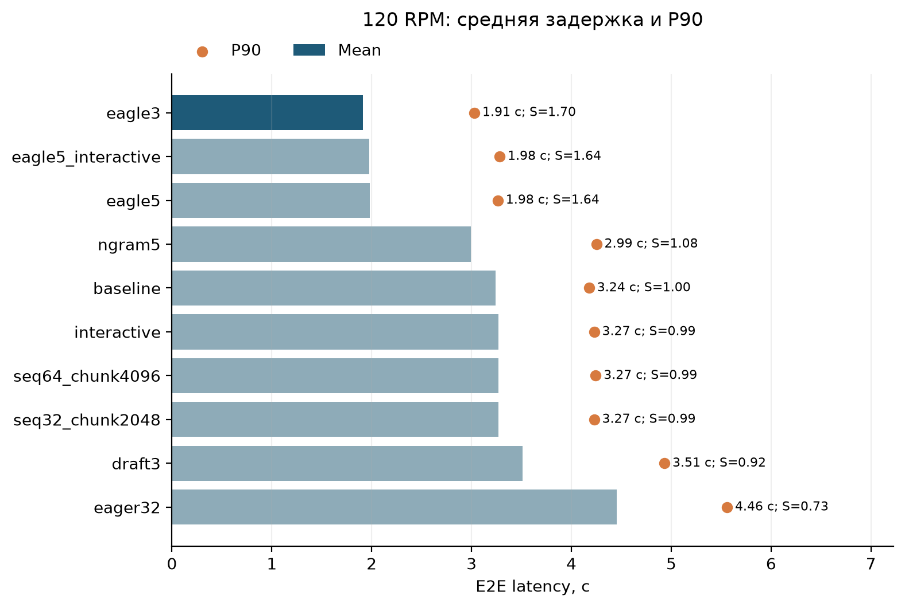
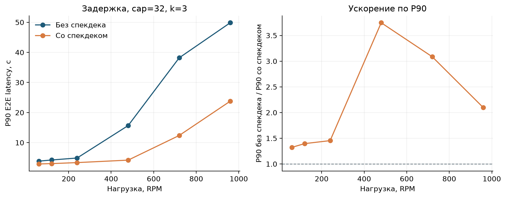
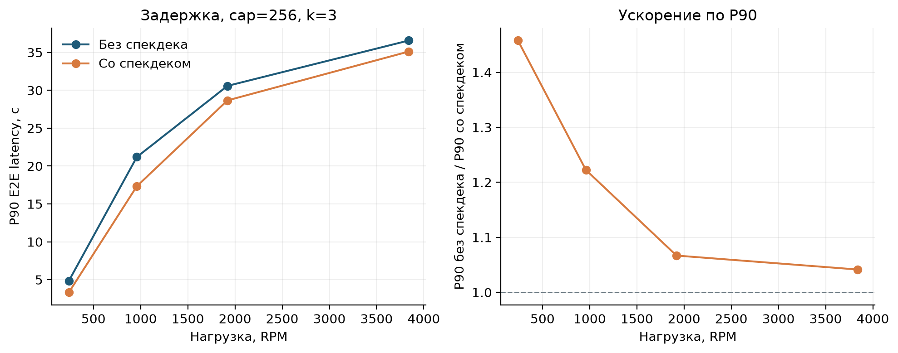
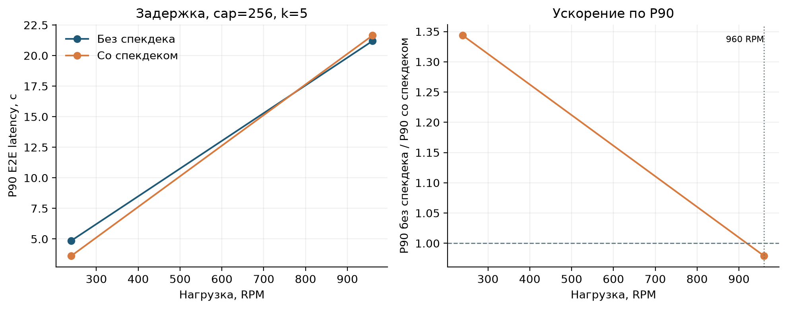
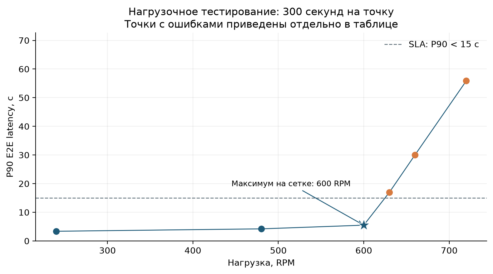

# ДЗ6: ускорение инференса

Qwen3-8B BF16, одна H100 80GB на avi-gn-fsk. Все 640 запросов из задания, temperature 0, seed 42, максимум 512 токенов, thinking выключен. vLLM 0.22.0, AIPerf 0.13.0. Перед каждым замером очищается prefix cache; прогрев не входит в метрики.

### 1. Настройки при 120 RPM

| Конфигурация | Mean, с | P90, с | Ускорение |
| --- | --- | --- | --- |
| baseline | 3.243 | 4.177 | 1.000 |
| seq32_chunk2048 | 3.272 | 4.228 | 0.991 |
| seq64_chunk4096 | 3.269 | 4.243 | 0.992 |
| eager32 | 4.456 | 5.558 | 0.728 |
| interactive | 3.269 | 4.228 | 0.992 |
| ngram5 | 2.993 | 4.251 | 1.083 |
| draft3 | 3.509 | 4.932 | 0.924 |
| eagle3 | 1.910 | 3.029 | 1.698 |
| eagle5 | 1.979 | 3.263 | 1.639 |
| eagle5_interactive | 1.976 | 3.282 | 1.641 |

Сначала менялись лимит последовательностей и chunked prefill, затем CUDA graphs и interactivity/-O3. После этого проверялись n-gram, draft Qwen3-0.6B и EAGLE-3 с 3 и 5 предлагаемыми токенами. Ускорение считается как Mean baseline / Mean варианта.

Лучший результат дал EAGLE-3 с k=3: задержка сократилась на 41%. Повтор дал 1.918 с вместо 1.910 с. Отключение CUDA graphs замедлило модель, остальные настройки без спекдека почти ничего не дали. Увеличение k до 5 тоже не помогло. Средняя длина ответов менялась примерно на 0.3%; качество текстов отдельно не оценивалось.

## 2. Как нагрузка влияет на спекдек

В каждой точке 640 запросов. Внутри пары настройки одинаковы, кроме спекдека. Сначала сравнивался EAGLE-3 k=3 при лимите 32 последовательности.

От 60 до 960 RPM EAGLE быстрее во всех точках. Максимальное ускорение по P90 на этой сетке 3.75 при 480 RPM, затем оно уменьшается до 2.10. У варианта без спекдека очередь растёт раньше.

При лимите 256 и k=3 пересечения тоже нет, даже на 3840 RPM. Ускорение постепенно приближается к единице.

У k=5 первая измеренная точка с проигрышем находится на 960 RPM: P90 21.643 с против 21.191 с без спекдека. При 240 RPM он ещё быстрее. Больше черновых токенов требует больше работы, а acceptance здесь около 21%. Между 240 и 960 RPM точный порог не уточнялся; на точку один прогон.

## 3. Максимальная нагрузка

Для выбранного eagle3 нагрузка подавалась по 300 секунд через load_test.sh. После грубой сетки граница уточнялась до интервала 600-630 RPM. SLA: P90 E2E < 15 с, без ошибок.

| RPM | P90, с | Успешных | Ошибок | SLA |
| --- | --- | --- | --- | --- |
| 240 | 3.373 | 1199 | 0 | PASS |
| 480 | 4.212 | 2399 | 0 | PASS |
| 600 | 5.498 | 2999 | 0 | PASS |
| 630 | 16.968 | 3149 | 0 | FAIL |
| 660 | 30.031 | 3299 | 0 | FAIL |
| 720 | 55.873 | 3599 | 0 | FAIL |
| 960 | 118.284 | 3446 | 1353 | FAIL |

Максимум на проверенной сетке: 600 RPM, то есть 10 RPS. При 630 RPM очередь уже поднимает P90 выше 15 секунд. На 960 RPM 28.2% запросов завершились по timeout; указанный P90 относится только к успешным ответам, поэтому эта точка не проходит SLA и не показана на графике.

Короткий прогон при 720 RPM дал P90 12.378 с, а тест на 300 секунд уже 55.873 с: очередь успевает накопиться. Для SLA длительность замера здесь существенна. Запросы в длинном тесте циклически повторяются; результат относится к этому датасету и одному инстансу.

Все сравнения выполнены в одном окружении. Из-за недоступного Docker модель запускалась нативно с CUDA 13.0 вместо cu129-образа задания. Команды конфигураций, полные таблицы и исходные замеры находятся в [hw6](https://github.com/mariklolik/dl-course-ai/tree/main/hw6).
