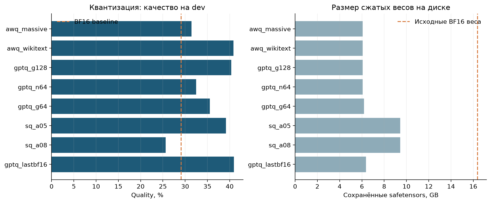
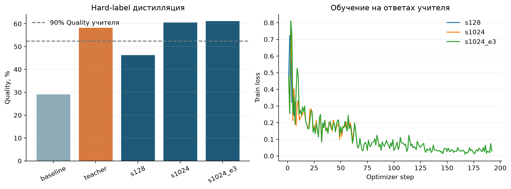

# ДЗ7: квантизация и дистилляция Qwen3

[Отчёт PDF](outputs/report.pdf) · [Текст отчёта](REPORT.md) · [Исполненный notebook](homework_compression_student.ipynb) · [Таблица](outputs/results.csv) · [Логи](outputs/raw_logs.zip) · [Checkpoint](https://huggingface.co/mariklolik228/dl-course-hw7-compression/tree/a6a6cac40b8e34b03798892199b225e34c685837)

**Лучший ученик: `s1024_e3`, Quality 0.6114 против 0.5823 у Qwen3-32B. Это 104.99% качества учителя; требуемый порог 90% достигнут.** Исходная Qwen3-8B даёт 0.2912. Уже одна эпоха на 1024 ответах проходит порог: Quality 0.6059.

Задача: по русскому запросу вернуть JSON с `intent` и `slots`. Учитель Qwen3-32B, baseline и ученик Qwen3-8B. Квантизация применялась к исходным весам 8B; дистилляция обучает отдельные копии этой же исходной модели.

| Модель | Quality | Intent Acc | Slot F1 | Frame EM | Valid JSON |
| --- | --- | --- | --- | --- | --- |
| baseline | 0.2912 | 0.3828 | 0.1995 | 0.1094 | 0.5312 |
| teacher | 0.5823 | 0.7852 | 0.3794 | 0.3164 | 0.9766 |
| s128 | 0.4628 | 0.6875 | 0.2381 | 0.1055 | 0.9453 |
| s1024 | 0.6059 | 0.7812 | 0.4306 | 0.3398 | 0.9805 |
| s1024_e3 | 0.6114 | 0.7891 | 0.4337 | 0.3398 | 0.9766 |

Все метрики в таблице находятся в диапазоне 0-1. `Quality = 0.5 × Intent Accuracy + 0.5 × Slot Micro F1`. Slots сравниваются как мультимножества пар: порядок не важен, лишние дубликаты дают false positives. Нормализация значений ограничена регистром и пробелами. Frame Exact Match требует одновременно правильного intent и точного набора slots. Valid JSON Rate учитывает синтаксис, схему и допустимые классы.

Данные MASSIVE ru-RU: 11 514 train-примеров, 60 intents и 54 типа slots из train. Для всех моделей один dev-срез из 256 примеров, shuffle с seed 42. Train и dev не пересекаются по ID. Test не использовался. Калибровка и ответы учителя берутся только из train.

Промпт и списки классов одинаковы. Greedy, seed 42, thinking выключен, максимум 128 новых токенов, batch 4 с левым padding. Лимит prompt 2048; запросы не обрезаются. `do_sample=False` и `use_model_defaults=False` заданы явно. JSON не исправляется, текст из code fences не извлекается. Невалидный ответ обнуляет intent/frame и даёт пустые predicted slots.

## 1. Квантизация

Проверены восемь конфигураций через `llmcompressor.oneshot`. Все настройки находятся в [configs.json](configs.json), исходные recipes, ID и длины calibration-примеров, схемы и SHA checkpoint сохранены в `artifacts_compression_hw/quantization`.

AWQ и GPTQ используют W4A16, симметричную квантизацию, group size 128. У GPTQ отдельно менялись N=256 на 64 и group size 128 на 64. В `gptq_lastbf16` дополнительно оставлен в BF16 последний decoder block, `model.layers.35`. SmoothQuant сравнивает alpha 0.5/0.8: веса INT8 по каналам, активации INT8 динамически по токенам. Во всех вариантах `lm_head`, embeddings и norm остаются BF16.

| Run | Quality | Intent Acc | Slot F1 | Frame EM | Valid JSON | GB | Сжатие |
| --- | --- | --- | --- | --- | --- | --- | --- |
| baseline | 0.2912 | 0.3828 | 0.1995 | 0.1094 | 0.5312 | 16.382 | 1.000 |
| awq_massive | 0.3141 | 0.4023 | 0.2259 | 0.1211 | 0.5664 | 6.071 | 2.698 |
| awq_wikitext | 0.4088 | 0.5352 | 0.2824 | 0.1289 | 0.7344 | 6.071 | 2.698 |
| gptq_g128 | 0.4037 | 0.5898 | 0.2176 | 0.1445 | 0.8047 | 6.071 | 2.698 |
| gptq_n64 | 0.3248 | 0.4570 | 0.1926 | 0.1016 | 0.6562 | 6.071 | 2.698 |
| gptq_g64 | 0.3553 | 0.4844 | 0.2262 | 0.1484 | 0.6094 | 6.180 | 2.651 |
| sq_a05 | 0.3918 | 0.5352 | 0.2484 | 0.1406 | 0.7031 | 9.439 | 1.736 |
| sq_a08 | 0.2564 | 0.3516 | 0.1612 | 0.1016 | 0.4727 | 9.439 | 1.736 |
| gptq_lastbf16 | 0.4097 | 0.5977 | 0.2218 | 0.1562 | 0.8125 | 6.358 | 2.577 |

GB = 10^9 байт. Размер считается по сохранённым `.safetensors`; коэффициент сжатия равен размеру исходных BF16-весов, делённому на размер checkpoint. Tokenizer и текстовые конфиги в этот коэффициент не входят. INT4-варианты дают 2.58-2.70 раза вместо четырёх из-за неквантизированных частей модели и служебных tensors: scale и group index тоже занимают место.



## 1.1. Что дали параметры

При одинаковых 256 примерах AWQ на WikiText получил Quality 0.4088 против 0.3141 на MASSIVE: +9.47 п.п. Valid JSON вырос с 0.5664 до 0.7344. Источник калибровки повлиял на результат этого запуска, но вместе с ним менялись язык, содержание и длина текста.

В MASSIVE-калибровке 128 957 токенов, в WikiText 152 499: на 18.26% больше при равном N. Диапазоны полных prompt: 493-528 и 493-912 токенов. В WikiText пропущено 137 пустых или не помещающихся примеров, затем добраны первые 256 подходящих после shuffle. Оба набора содержат тот же системный промпт со списком классов. Поэтому сравнение источников одновременно меняет и бюджет токенов.

У GPTQ переход с 256 на 64 примера снизил Q с 0.4037 до 0.3248, на 7.89 п.п. N64 является точным prefix тех же 256 примеров: 32 249 токенов. Размер весов при этом тот же. Уменьшение group size до 64 тоже не повысило Q: 0.3553 против 0.4037, при росте файла с 6.071 до 6.180 GB. Более мелкая группа здесь не дала выигрыша по конечной метрике задачи.

SmoothQuant чувствителен к alpha: 0.5 даёт Q 0.3918, 0.8 даёт 0.2564, разница -13.54 п.п. При alpha 0.8 результат ниже исходного baseline на 3.48 п.п. Состав калибровки, битность и loader одинаковы. Alpha перераспределяет масштабы между весами и активациями, поэтому более сильное сглаживание само по себе не гарантирует лучший итог после квантизации. Отдельные ошибки весов и активаций здесь не измерялись.

Сохранение последнего блока в BF16 повысило Q с 0.4037 до 0.4097, на 0.60 п.п. Размер вырос с 6.071 до 6.358 GB. Квантизуются 245 Linear вместо 252; dtype последнего блока проверен по сохранённым tensors. Это одна проверенная позиция блока, перебора всех слоёв нет.

Максимальный наблюдаемый Q среди квантованных вариантов: gptq_lastbf16, 0.4097. AWQ WikiText даёт 0.4088; разница между ними всего 0.09 п.п. При этом у последнего BF16-блока выше Intent Accuracy, а у AWQ WikiText выше Slot F1. Выводы относятся к одному фиксированному dev и одному seed; близкие значения не доказывают устойчивое преимущество.

Оценка проходит после сохранения и повторной загрузки checkpoint. Веса распаковываются в BF16 с сохранением fake quantization; W8A8 также моделирует INT8-квантизацию активаций. Для W8A8 после reload проверяются BF16 веса, FROZEN, включённые wrappers и dynamic INT8 у всех 252 соответствующих модулей. Таблица показывает качество и размер сжатых файлов на диске. Скорость оптимизированных INT4/INT8-ядер и runtime-память в этой работе не измерялись.

## 2. Hard-label дистилляция

Учитель дал жадные ответы на 1024 train-примера, выбранных shuffle с seed 42. Все ответы закончились EOS; 1003 прошли строгую проверку JSON. Все 21 невалидный ответ сохранены и включены в обучение. Фильтрации и подмены teacher labels разметкой MASSIVE нет. Всего 515 841 prompt token и 21 655 answer tokens вместе с EOS.

Каждый запуск начинается с исходной Qwen3-8B. Обучаются все 8 190 735 360 параметров, без LoRA. BF16, gradient checkpointing, batch 1, accumulation 16, AdamW с `foreach=False`, lr 2e-5, cosine scheduler, warmup 5%, gradient clipping 1.0. Фактический weight decay оптимизатора 0.01. Параметры, градиенты и moment buffers BF16; FP32 в optimizer state используется для счётчиков шагов. Промпт и padding замаскированы -100, EOS ответа остаётся целевым токеном.

| Run | N | Эпохи | Шаги | Train, с | Answer tokens |
| --- | --- | --- | --- | --- | --- |
| s128 | 128 | 1 | 8 | 32.59 | 2699 |
| s1024 | 1024 | 1 | 64 | 240.47 | 21655 |
| s1024_e3 | 1024 | 3 | 192 | 857.77 | 64965 |

В таблице токены ответа являются supervised targets. Sequence tokens, включающие prompt, равны 67 173 / 537 496 / 1 612 488. Их не следует смешивать с количеством целевых токенов. Чекпоинты сохраняются только в конце запуска; результаты dev получены после их повторной загрузки.



Основное изменение в этом переборе даёт переход с 128 на 1024 ответа при одной эпохе: Q 0.4628 → 0.6059, +14.31 п.п. Одновременно растут покрытие train и число обновлений, с 8 до 64; отдельно эти два эффекта не разделялись.

На 128 примерах модель уже гораздо чаще возвращает допустимый ответ, но Frame Exact Match остаётся 27/256 против 28/256 у baseline. На 1024 примерах получается 87/256. Дополнительные две эпохи дают ещё 0.55 п.п. Q, с 0.6059 до 0.6114, при том же Frame Exact Match 87/256. Один проход на 1024 примерах уже выполняет порог 90% качества учителя.

Финальный checkpoint выбран по максимальному dev Quality среди трёх завершённых запусков. `student_sft` побайтово совпадает с reload-оцененным `students/s1024_e3`; SHA всех файлов проверены. На этом dev у ученика Intent Accuracy 0.7891 против 0.7852 у учителя, Slot Micro F1 0.4337 против 0.3794. Именно разница в slots составляет основную часть наблюдаемого выигрыша по Q.

Один seed и один dev-срез. Разница между одной и тремя эпохами мала; устойчивость ранжирования на других разбиениях не оценивалась. График loss содержит реальные записи без сглаживания. У N128 и N1024 разные обучающие выборки, поэтому их loss не является оценкой на едином контрольном наборе.

## 3. Ошибки в ответах

У baseline 120/256 ответов не проходят строгий parser. В 107 случаях после корректного JSON стоит ещё одна `}`. При таком протоколе ошибка одного символа обнуляет ответ целиком. Поэтому изменения Valid JSON заметно влияют на итоговый Q, и рост Q после квантизации нельзя автоматически приписать улучшению понимания запросов.

Пример dev ID 5021: «мне нравится r n b». Эталон:

```json
{"intent":"music_likeness","slots":[["music_genre","r n b"]]}
```

Baseline добавляет в конце вторую `}`. Учитель и выбранный ученик возвращают точный ответ. Ошибка формата считается ошибкой всего ответа, хотя intent и slot внутри исходного текста baseline совпадают с эталоном.

Пример dev ID 11061: «пожалуйста добавь васю в список контактов». Gold slot: `["person","васю"]`. Учитель и ученик возвращают `["person","вася"]`. Тип и intent правильные, но значение приведено к другой форме вместо дословного копирования. Нормализация метрики это не исправляет; слот даёт одновременно FP и FN. Ученик сохраняет часть ошибок учителя.

Полные ответы, распределение типов ошибок и выбранные примеры находятся в `outputs/error_analysis.json`. Примеры выбираются кодом из общего dev, без изменения исходных предсказаний.

## 4. Воспроизведение и артефакты

Все эксперименты и сборка отчёта выполнены на avi-gn-fsk34, NVIDIA H100 80GB. Каждая модель использует одну GPU. Python 3.12.14, Torch 2.8.0+cu128 / CUDA 12.8, Transformers 4.55.2, datasets 4.1.1, llmcompressor 0.8.1, compressed-tensors 0.12.2. Пик allocated при full SFT около 63.4 GiB. Для графиков и PDF отдельное CPU-окружение: matplotlib 3.11.2, ReportLab 5.1.0, Pillow 13.0.0, NumPy 2.4.6; ML использует NumPy 2.2.6. Версии зафиксированы в requirements и freeze-файлах.

Исходные dev predictions и метрики находятся в `artifacts_compression_hw/evaluations`, ответы учителя в `teacher_answers/answers.jsonl`, история и конфигурация SFT в `training`. В `data` сохранены точные train/dev ID, тексты, gold и SHA256. `model_manifest.json` фиксирует revisions и хеши исходных моделей. `outputs/results.csv` собирается из исходных predictions с независимым пересчётом всех пяти метрик.

Веса всех восьми quantized моделей и выбранного ученика доступны [в публичном Hugging Face repo](https://huggingface.co/mariklolik228/dl-course-hw7-compression/tree/a6a6cac40b8e34b03798892199b225e34c685837). Immutable revision: `a6a6cac40b8e34b03798892199b225e34c685837`. Manifest содержит 189 файлов, 72.226 GB с tokenizer/config. `restore_artifacts.py` материализует их в `artifacts_compression_hw` и проверяет размер/SHA каждого файла без авторизации.

Скачанный из публичного repo ученик повторно оценён на той же dev-выборке: все 256 ответов и все пять метрик совпали с исходным результатом. Receipt и предсказания сохранены в `verification/external_student`. Исполненный notebook содержит 39 ячеек, 23 кодовые; ошибок исполнения нет.

```bash
python3.12 -m venv .venv
.venv/bin/python -m pip install -r requirements.txt
export PATH="$PWD/.venv/bin:$PATH"
bash run_all.sh

.venv/bin/python -m venv .report
.report/bin/python -m pip install -r requirements-report.txt
.report/bin/python analyze.py
.report/bin/python report.py
```

Команды выполняются из `hw7`; перед GPU-этапами нужно назначить свободную выделенную GPU через `CUDA_VISIBLE_DEVICES`. GPU-этапы требуют свободную H100 80GB и одну видимую CUDA GPU. `run_all.sh` пропускает завершённые этапы по сохранённым результатам. Для полного запуска с нуля сохранённый каталог `artifacts_compression_hw` нужно предварительно перенести в backup, чтобы cache не пропустил этапы. Для повторной оценки опубликованных весов сначала выполняется `.venv/bin/python restore_artifacts.py`. Проверка скачанного ученика с повторной генерацией: `.venv/bin/python verify_external.py`. Результат внешней проверки хранится отдельно от 13 основных dev-прогонов.

Для W8A8 в фиксированной паре Transformers 4.55.2 / compressed-tensors 0.12.2 используется штатная загрузка compressed layout и затем `ModelCompressor.decompress_model`. Это обходит ошибку назначения INT8 параметра с `requires_grad=True`. Активационная fake quantization сохраняется; состояние и реальный wrapper проверены regression-тестом и на полном checkpoint. У SQ alpha 0.5 после сбоя повторена только оценка уже сохранённых весов. Не сохранённые до сбоя времена PTQ/save и пики CUDA отмечены `null` в metadata.

Явный greedy-режим проверен отдельным тестом: model-specific defaults не должны включать sampling. Первый ошибочный sampled-запуск и промежуточные сбои находятся в `incidents`; в таблицы и выбор модели они не входят. Проверки: строгий parser, duplicate slots, EOS/pad mask, native INT8 reload, wrapper/FROZEN, SHA/ID, положительное изменение обучаемых весов и независимый пересчёт метрик.

Источники: [MASSIVE, AmazonScience, CC BY 4.0](https://huggingface.co/datasets/AmazonScience/massive), [WikiText](https://huggingface.co/datasets/Salesforce/wikitext), [Qwen3-8B](https://huggingface.co/Qwen/Qwen3-8B), [Qwen3-32B](https://huggingface.co/Qwen/Qwen3-32B), [LLM Compressor 0.8.1](https://github.com/vllm-project/llm-compressor/tree/0.8.1), [compressed-tensors 0.12.2](https://github.com/neuralmagic/compressed-tensors/tree/0.12.2). Модели Qwen распространяются по Apache 2.0; копия лицензии и описание изменений включены в опубликованные checkpoint.
