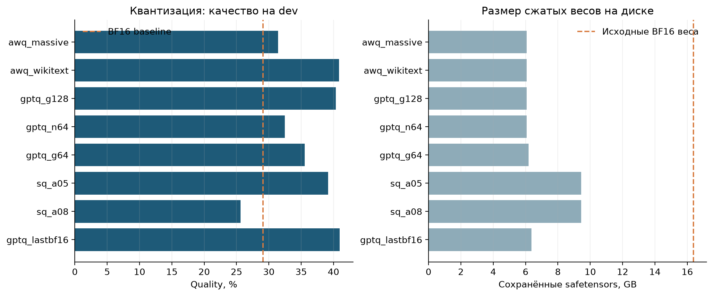
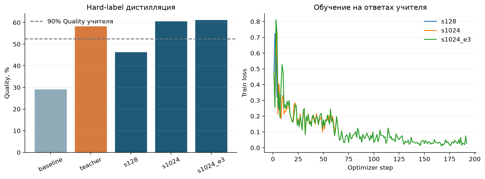

# ДЗ7: квантизация и дистилляция

Задача: вернуть JSON с intent и slots для MASSIVE ru-RU. Baseline и ученик Qwen3-8B, учитель Qwen3-32B. Все модели оцениваются на одних 256 dev-примерах, seed 42, greedy, без thinking, максимум 128 новых токенов. Обучение и калибровка используют только train. Эксперименты выполнены на avi-gn-fsk, одна H100 80GB на модель.

Quality = (Intent Accuracy + Slot Micro F1) / 2. JSON проверяется строго, без исправлений; Frame EM требует точного intent и всех slots. В таблицах метрики от 0 до 1.

### 1. Квантизация

AWQ и GPTQ: W4A16, group size 128, 256 примеров калибровки. Отдельно менялись источник калибровки, число примеров, group size и последний блок в BF16. SmoothQuant: W8A8, alpha 0.5 или 0.8. Embeddings, norm и lm_head остаются BF16.

| Вариант | Quality | Intent Acc | Slot F1 | Frame EM | Valid JSON | GB | Сжатие |
| --- | --- | --- | --- | --- | --- | --- | --- |
| baseline | 0.2912 | 0.3828 | 0.1995 | 0.1094 | 0.5312 | 16.382 | 1.000 |
| awq_massive | 0.3141 | 0.4023 | 0.2259 | 0.1211 | 0.5664 | 6.071 | 2.698 |
| awq_wikitext | 0.4088 | 0.5352 | 0.2824 | 0.1289 | 0.7344 | 6.071 | 2.698 |
| gptq_g128 | 0.4037 | 0.5898 | 0.2176 | 0.1445 | 0.8047 | 6.071 | 2.698 |
| gptq_n64 | 0.3248 | 0.4570 | 0.1926 | 0.1016 | 0.6562 | 6.071 | 2.698 |
| gptq_g64 | 0.3553 | 0.4844 | 0.2262 | 0.1484 | 0.6094 | 6.180 | 2.651 |
| sq_a05 | 0.3918 | 0.5352 | 0.2484 | 0.1406 | 0.7031 | 9.439 | 1.736 |
| sq_a08 | 0.2564 | 0.3516 | 0.1612 | 0.1016 | 0.4727 | 9.439 | 1.736 |
| gptq_lastbf16 | 0.4097 | 0.5977 | 0.2218 | 0.1562 | 0.8125 | 6.358 | 2.577 |

AWQ на WikiText дал Q 0.4088 против 0.3141 на MASSIVE. При равных 256 примерах в WikiText оказалось на 18.3% больше токенов, поэтому здесь менялись и источник, и объём текста. GPTQ с 64 примерами хуже варианта с 256; уменьшение group size до 64 тоже не помогло.

SmoothQuant с alpha 0.8 оказался хуже baseline. Сохранение последнего блока в BF16 немного улучшило GPTQ, но увеличило размер. Его Q 0.4097 почти совпадает с AWQ WikiText, 0.4088. На одном dev-срезе такая разница слишком мала для уверенного выбора по качеству.

GB = 10^9 байт, размер только весов. INT4 уменьшил файлы примерно в 2.6-2.7 раза. Оценка после сохранения и загрузки использует BF16 с fake quantization; W8A8 также моделирует квантизацию активаций. Скорость специализированных INT4/INT8-ядер здесь не измерялась.

## 2. Hard-label дистилляция

Учитель сгенерировал ответы для 1024 train-примеров. Все ответы пошли в обучение, включая 21 невалидный JSON. Каждый ученик обучался из исходной Qwen3-8B: full SFT, BF16, batch 1, accumulation 16, lr 2e-5, AdamW, cosine scheduler, warmup 5%. Loss считается только по ответу.

| Модель | Quality | Intent Acc | Slot F1 | Frame EM | Valid JSON |
| --- | --- | --- | --- | --- | --- |
| baseline | 0.2912 | 0.3828 | 0.1995 | 0.1094 | 0.5312 |
| teacher | 0.5823 | 0.7852 | 0.3794 | 0.3164 | 0.9766 |
| s128 | 0.4628 | 0.6875 | 0.2381 | 0.1055 | 0.9453 |
| s1024 | 0.6059 | 0.7812 | 0.4306 | 0.3398 | 0.9805 |
| s1024_e3 | 0.6114 | 0.7891 | 0.4337 | 0.3398 | 0.9766 |

| Запуск | Примеров | Эпох | Шагов | Время, с |
| --- | --- | --- | --- | --- |
| s128 | 128 | 1 | 8 | 32.59 |
| s1024 | 1024 | 1 | 64 | 240.47 |
| s1024_e3 | 1024 | 3 | 192 | 857.77 |

Основной прирост дал переход с 128 на 1024 ответа: Q вырос с 0.4628 до 0.6059. Вместе с выборкой увеличилось число шагов, поэтому влияние объёма данных и вычислений здесь не разделяется. Ещё две эпохи добавили только 0.0055 Q; Frame EM остался тем же.

Лучший из трёх запусков по dev Quality: s1024_e3, 0.6114, или 104.99% качества учителя. Порог 90% достигнут уже за одну эпоху. Ученик лучше учителя прежде всего по Slot F1. Все варианты проверены на одном dev-срезе с одним seed.

У baseline 120 невалидных ответов из 256, в 107 случаях причина в лишней закрывающей скобке. На Quality сильно влияет валидность JSON. Дистилляция тоже не убирает все ошибки: в запросе "добавь васю в список контактов" учитель и ученик возвращают slot "вася" вместо дословного "васю".

Код, исполненный notebook, ответы учителя и исходные оценки находятся в [hw7](https://github.com/mariklolik/dl-course-ai/tree/main/hw7), веса в [Hugging Face](https://huggingface.co/mariklolik228/dl-course-hw7-compression). Повторная оценка скачанного ученика воспроизвела все 256 ответов.
