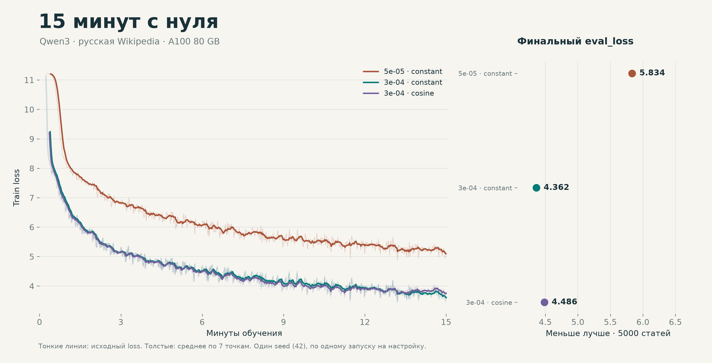
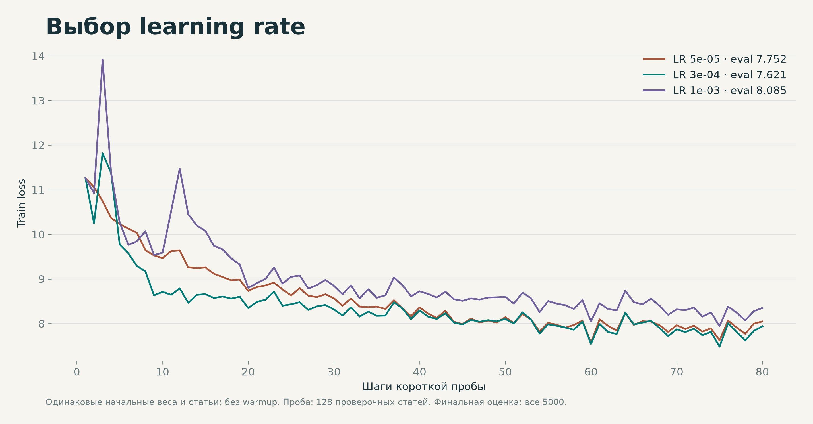
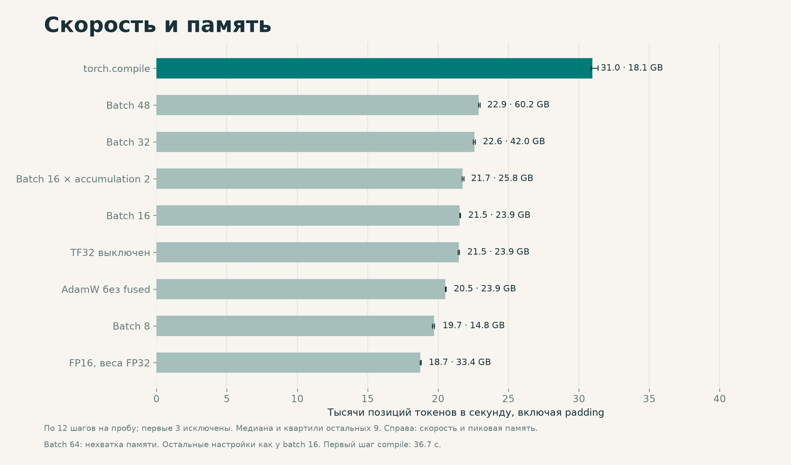

Обучил Qwen3 с нуля: 960 881 664 параметра, одна A100 80 GB. Данные: wikimedia/wikipedia, 20231101.ru; первые 5000 статей для проверки. Токенизатор ai-forever/rugpt3small_based_on_gpt2, длина 512, seed 42. Каждый запуск обучался 900 секунд; начальная и финальная проверки в этот бюджет не входят.

Сделал 13 коротких проб: batch 8/16/32/48/64 (64: OOM), accumulation 1/2, AdamW/fused, compile, BF16/FP16 (FP16 с весами FP32), TF32 и три LR. Для полных запусков выбрал batch 16, accumulation 1, BF16, TF32, fused AdamW и compile.

LR проверял 80 шагов на первых 128 проверочных статьях: 5e-05: 7.752; 3e-04: 7.621; 1e-03: 8.085. Выбрал 3e-4. Полные запуски использовали одинаковые GPU, seed и данные; финальная оценка на всех 5000 статьях.

| LR / warmup / scheduler | eval_loss | PPL | Секунды | Шаги |
| --- | --- | --- | --- | --- |
| 5e-5, warmup 200, constant | 5.834 | 341.7 | 900.27 | 3053 |
| 3e-4, warmup 20, constant | 4.362 | 78.4 | 900.26 | 3051 |
| 3e-4, warmup 20, cosine 3400 | 4.486 | 88.8 | 900.14 | 3056 |

Начальный eval_loss: 11.218. После constant: 4.362, PPL = exp(eval_loss) = 78.4. Это сравнение по одному запуску: проверочная выборка использовалась и для выбора настроек.







Фрагменты greedy-генераций, до обучения и после (constant):

Москва

До: «Москва успешно element энергетической ангелтонос…»

После: «Москва.

В конце XIX — начале XX века в селе было образовано село.

В начале XX века село входило в…»

Солнечная система

До: «Солнечная система множества столетий sea читаю Армия…»

После: «Солнечная система — деревня в составе Поддубского сельского поселения Поддубского района Республики…»

Модель переняла форму энциклопедической статьи, но путает объекты: Солнечная система стала деревней. В полных генерациях есть повторы. Снижение loss показывает, что предсказывать токены стало легче; достоверность текста из этого не следует.

[Полные генерации](generations.json) · [Логи и настройки](logs.zip)

```bash
pip install -r requirements.txt
python your_solution.py prepare --data-dir data
unzip logs.zip "settings/*.json"
CUDA_VISIBLE_DEVICES=0 python your_solution.py train --data-dir data --output-dir runs/constant --settings settings/constant.json
python plot_results.py
```

[Код и файлы](https://github.com/mariklolik/dl-course-ai/tree/main/mini-pretrain)
